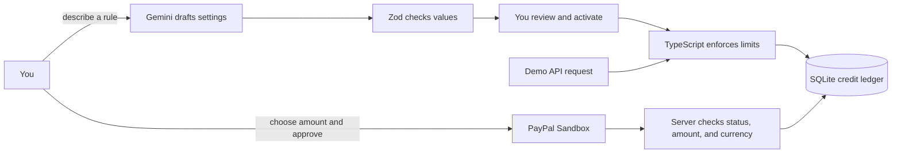

# QuotaPilot

QuotaPilot is a local learning project for watching API credit use, setting limits, estimating when credits may run out, and trying a user-approved PayPal Sandbox top-up.

The AI only turns a written rule into a draft. TypeScript validates and enforces that rule. A person must review and activate a policy, choose any top-up, and approve the payment on PayPal. The app never charges automatically.

## Run it on your Mac

You need Node.js and npm installed.

1. Open the `quotapilot` folder in Codex.
2. In the project terminal, install the packages:

   ```bash
   npm install
   ```

3. Create your private local settings file:

   ```bash
   cp -n .env.example .env
   ```

4. Set up the local database and sample account:

   ```bash
   npm run db:setup
   ```

5. Start the website:

   ```bash
   npm run dev
   ```

6. Open [http://localhost:3000](http://localhost:3000).

The dashboard and demo credit request work locally without external keys. To draft policies with Gemini, add a Google AI Studio API key as `GEMINI_API_KEY` in `.env`. PayPal checkout needs Sandbox application credentials in `PAYPAL_CLIENT_ID` and `PAYPAL_CLIENT_SECRET`. Keep `.env` private; never commit it or paste keys into chat. A starter policy is seeded as an inactive draft so you can try enforcement without an AI key.

## What is in the project

- **Stage 1 — Foundation:** Next.js, TypeScript, SQLite, Prisma migrations, and a seeded demo account.
- **Stage 2 — Metered API:** atomic credit deduction, usage recording, mode allowlists, and daily limits.
- **Stage 3 — AI policy engine:** Gemini structured output, Zod validation, inactive drafts, and deterministic policy enforcement.
- **Stage 4 — Forecasting and decisions:** naïve, five-hour SMA, and SES forecasts; depletion estimates; synthetic-profile MAE comparisons; and a saved recommendation history.
- **Stage 5 — PayPal Sandbox:** server-side order creation and capture, GBP amount checks, idempotent credit allocation, and user approval.
- **Stage 6 — Dashboard:** balance, policies, usage, forecasts, recommendation explanations, MAE benchmark results, and top-up history.

## How the safety boundary works



The forecasting numbers are estimates based on the last 24 hours of recorded use. The MAE table measures model errors on small synthetic examples; it does not prove which method will be best for future usage.

## Useful project commands

- `npm run db:setup` — apply migrations and create the sample account and starter policy.
- `npm run dev` — start the local website.
- `npm run lint` — check code style and common mistakes.
- `npm run typecheck` — check TypeScript types.
- `npm test` — run automated tests using a separate `integration-test.db` file.
- `npm run benchmark:forecasting` — print MAE comparisons for the sample usage patterns.
- `npm run build` — create a production build.

## Current limits

This is an educational prototype with a shared demo account and no sign-in. Do not deploy it publicly or use real payment credentials. PayPal integration is Sandbox-only. There are no real API provider calls, webhook reconciliation, user accounts, or production hosting setup yet.

See [PROJECT_PLAN.md](./PROJECT_PLAN.md) for the beginner-friendly phase guide and glossary.
